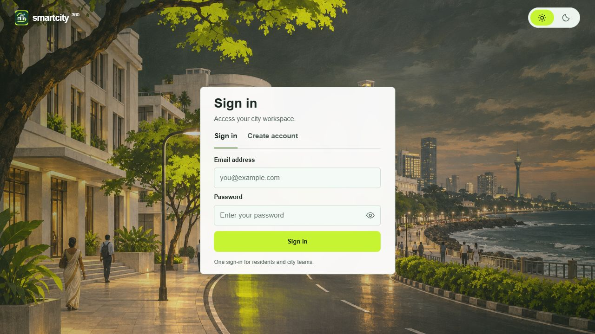
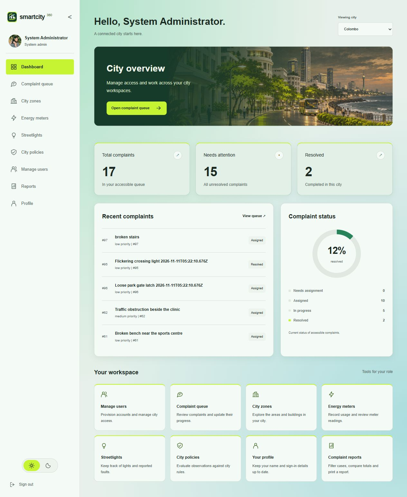
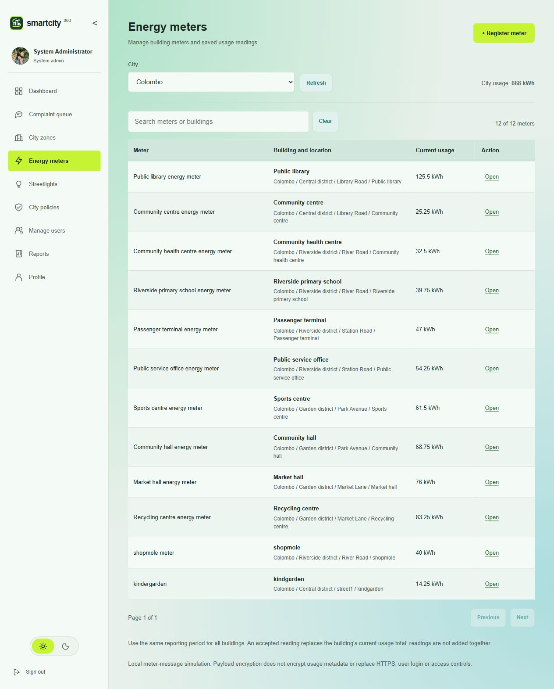

# SmartCity360

SmartCity360 is a Java web application for managing city infrastructure and resident service requests. Residents report problems and follow their cases; city teams manage complaints, city zones, energy meters, streetlights and policy rules according to their permissions.

Built with **Java 21, Jakarta EE 11, Jakarta REST, JPA, PostgreSQL, Tailwind CSS and plain JavaScript**, and deployed as a Maven WAR on **Payara Community 7**. This project does not use Spring Boot or a standalone Java `main` method.

## Application preview

Screenshots show the local application with sample records captured on 11 November 2026. Records and counts can change as the application is used.

### Sign in



### Dashboard



### Energy meters



## Features

| Module | Available functionality |
| --- | --- |
| Accounts | Resident signup, sign-in/out, five roles, administrator provisioning, account status and activity |
| Profile | Photo upload/removal, display name, username, phone, password changes and font preference |
| Dashboard | Accessible complaint totals, current status chart, recent cases and role-specific shortcuts |
| Complaints | Resident submission, severity routing, employee assignment, public messages, private staff notes, resolution and reviewed reopening |
| City zones | City/district/street/building hierarchy, folder navigation, usage totals and simulated subtree power commands |
| Energy meters | Building-linked registration, saved readings, optional authentication/compression/encryption and payload recovery checks |
| Streetlights | Reusable lamp configurations, individual power/fault states, filters and an isolated object-sharing demonstration |
| City policies | Boolean rule language, syntax validation, saved revisions, observations and evaluation snapshots |
| Reports | Complaint filters, totals, monthly submission chart, matching records and browser printing |
| Appearance | Remembered light/dark themes, collapsible desktop sidebar, mobile drawer and configurable colors/fonts |

Profile is the last navigation entry for every role. Forms and record details open separately where applicable. Server-side permission checks apply even when a user bypasses the interface.

## Roles

| Role | Main access |
| --- | --- |
| Resident | Own complaints, public replies, reopening requests, own reports and profile |
| Local staff | Assigned-city operations and complaints within the local authority tier |
| Supervisor | Assigned-city operations, eligible employee assignment and complaints within permitted tiers |
| City manager | All complaint tiers in the assigned city, policy management and hierarchy power commands |
| System administrator | Cross-city administration, user management, city creation and shared configuration management |

Only residents submit complaints. Administrators and staff work with existing cases. Every role has Dashboard and Profile; other navigation depends on permissions. See [the complete permission matrix](docs/ACCOUNTS.md).

## Five design patterns

| Assessment part | Pattern | Application responsibility | Source package |
| --- | --- | --- | --- |
| A | Decorator | Add optional authentication, compression and encryption to meter messages | `pattern/decorator` |
| B | Composite | Apply usage and power operations through the city hierarchy | `pattern/composite` |
| C | Chain of Responsibility | Route complaints through local staff, supervisor and city-manager authorities | `pattern/chain` |
| D | Flyweight | Share immutable lamp configurations between individual streetlights | `pattern/flyweight` |
| E | Interpreter | Parse and evaluate city policy expressions | `pattern/interpreter` |

These packages are under `src/main/java/lk/osini/smartcity360`. REST resources handle HTTP requests; services enforce access and transactions; entities map saved records to PostgreSQL. Builder and Visitor are not implemented.

## Requirements

- JDK 21, selected for both the IntelliJ project SDK and Maven runner.
- Maven 3.9 or later, available in the terminal.
- Payara Community 7 with Jakarta EE 11 support.
- PostgreSQL Windows binaries. The existing local setup uses PostgreSQL 18 on port **5433**.
- IntelliJ IDEA Ultimate or another Java IDE.
- Node.js and npm only for rebuilding Tailwind styles or running JavaScript checks.

The checked-in CSS allows Maven to package the application without an npm build. The helper scripts below target Windows PowerShell. Internet access is needed for the first Maven dependency download.

Expected local folder arrangement:

```text
OODP2/
  smartcity360/          # This repository
  tools/
    payara7/            # Payara installation
    pgsql/              # PostgreSQL binaries, including bin/psql.exe
```

Payara and PostgreSQL installations are not included in the repository. The scripts default to Java at `C:\Program Files\Java\jdk-21`; the daily launcher defaults to Maven at `C:\maven\apache-maven-3.9.14`. Adjust the parameters if your installations differ. The bootstrap helper expects the PostgreSQL folder arrangement shown above.

## First-time setup

Open `pom.xml` as a project in IntelliJ, select JDK 21 and reload Maven. Run these commands from the project root in IntelliJ's PowerShell terminal. Finish each step successfully before proceeding.

### 1. Build and create the local services

```powershell
mvn package
powershell.exe -NoProfile -ExecutionPolicy Bypass -File .\scripts\server.ps1 -Action Setup
powershell.exe -NoProfile -ExecutionPolicy Bypass -File .\scripts\database.ps1 -Action Setup
powershell.exe -NoProfile -ExecutionPolicy Bypass -File .\scripts\server.ps1 -Action Start
```

Database setup creates the local database/application role and applies all numbered SQL files in `database/` in filename order, currently `001` through `011`. This includes complaint assignment, follow-up and profile changes. Apply the complete schema before deploying the current application.

### 2. Configure the datasource and deploy

```powershell
powershell.exe -NoProfile -ExecutionPolicy Bypass -File .\scripts\database.ps1 -Action ConfigurePayara
powershell.exe -NoProfile -ExecutionPolicy Bypass -File .\scripts\server.ps1 -Action Stop
powershell.exe -NoProfile -ExecutionPolicy Bypass -File .\scripts\server.ps1 -Action Start
powershell.exe -NoProfile -ExecutionPolicy Bypass -File .\scripts\server.ps1 -Action Deploy
```

The configuration installs the PostgreSQL JDBC driver and creates `jdbc/SmartCity360DS`. The restart loads that driver. The deployed file is `target/smartcity360.war`, with application context `/smartcity360`.

### 3. Create the first administrator

```powershell
powershell.exe -NoProfile -ExecutionPolicy Bypass -File .\scripts\bootstrap-admin.ps1
```

Read the initial login privately from `.local/bootstrap-admin.json`, sign in and change the temporary password in **Profile > Security**. There is no public default password in this repository. Bootstrap is for a new installation; it does not reset an existing administrator.

Use **Manage users** to create staff accounts and assign their city. Residents use **Create account** on the sign-in page. See [account setup](docs/ACCOUNTS.md), [database details](docs/DATABASE.md) and [server configuration](docs/LOCAL_DEVELOPMENT.md).

## Run an already configured installation

From the project root:

```powershell
powershell.exe -NoProfile -ExecutionPolicy Bypass -File .\scripts\run-local.ps1
```

This builds using cached Maven dependencies, skips tests, starts the existing database/server if needed and redeploys the application. Run `mvn package` online first on a new computer to fill the dependency cache. Services continue running after the launcher finishes.

For different Java/Maven paths:

```powershell
powershell.exe -NoProfile -ExecutionPolicy Bypass -File .\scripts\run-local.ps1 -JavaHome 'C:\path\to\jdk-21' -MavenHome 'C:\path\to\apache-maven'
```

Open [SmartCity360 sign in](http://localhost:9080/smartcity360/login.html). After a frontend deployment, press **Ctrl+F5** if the previous interface remains cached. [Add the launcher to IntelliJ's Tools menu](docs/INTELLIJ_RUN.md).

| Local endpoint | Purpose |
| --- | --- |
| `http://localhost:9080/smartcity360/login.html` | Sign in or register |
| `http://localhost:9080/smartcity360/home.html` | Role dashboard |
| `http://localhost:9080/smartcity360/api/health` | Application health |
| `http://localhost:9048/` | Local Payara administration |
| `127.0.0.1:5433` | PostgreSQL database connection |

Health returns `{"application":"SmartCity360","status":"UP"}`. It checks that the application responds, not that every database workflow works. Sign in and load the city selector to exercise database access.

To stop services, stop Payara first, then PostgreSQL:

```powershell
powershell.exe -NoProfile -ExecutionPolicy Bypass -File .\scripts\server.ps1 -Action Stop
powershell.exe -NoProfile -ExecutionPolicy Bypass -File .\scripts\database.ps1 -Action Stop
```

## Data and credentials

The existing local installation has sample records across Colombo, Kandy, Galle, Jaffna and Kurunegala. A GitHub clone or source ZIP does **not** contain that running database or its accounts. New installations require account provisioning and data setup.

[Sample-data helpers](docs/SAMPLE_DATA.md) can populate the prepared local environment. They require the documented private account configuration and existing cities; they are not a one-command fresh-database installer. Preview their work before using `--apply`.

Keep `.local/`, database passwords, account credentials and the Payara encryption key private. Do not delete `.local/` as a cleanup step: it holds the local database files. Back up the database and meter encryption key together to preserve recovery of encrypted readings.

## Build, test and customize

```powershell
mvn test
mvn package
node --test scripts/verify-feedback.cjs scripts/verify-auth-session.cjs scripts/verify-report-model.cjs scripts/verify-city-explorer.cjs
```

Recorded verification on 11 November 2026: **67 Java tests**, including **33 pattern tests**; **21 client checks**; **106 live role checks**; and **42 live complaint write/isolation checks**. These suites overlap and their totals should not be added together. They are recorded results, not tests rerun whenever this README changes.

Live scripts need the running services and private account fixtures. The live complaint journey requires `--apply` and retains cases. Some older feature scripts create extra test cities or assume previous permissions; consult [verification scope](docs/VERIFICATION.md) and [the later checkpoint](docs/UI_CHECKPOINT.md) before running them.

To rebuild Tailwind after changing utility classes:

```powershell
npm ci
npm run build:css
mvn package
```

- Colors and font stacks: `src/main/webapp/assets/css/themes.css`.
- Shared layout refinements: `src/main/webapp/assets/css/refinements.css`.
- Profile layout: `src/main/webapp/assets/css/profile.css`.
- Navigation: `src/main/webapp/assets/js/shell.js`.

Rebuild and redeploy after changes. See [theme configuration](docs/DESIGN.md).

## Troubleshooting

| Problem | What to check |
| --- | --- |
| No Java main class to run | Use Maven packaging and Payara deployment; this is a WAR application. |
| Offline Maven cannot resolve a dependency | Run `mvn package` with internet access before using the offline launcher. |
| Database connection fails | Check PostgreSQL on port 5433, datasource setup and the server log. |
| Missing tables or columns | Apply all numbered database scripts using the setup helper before deploying current code. |
| Old interface after deployment | Press Ctrl+F5 and confirm the latest WAR was deployed. |
| Profile is the only accessible page | Change the account's temporary password in Profile > Security. |
| Missing operational tabs | Residents cannot access staff modules; staff scope also depends on their assigned city. |
| Incomplete application registration | Follow the explicit repair steps in the IntelliJ run guide. |

## Project structure and guides

```text
src/main/java/lk/osini/smartcity360/
  pattern/     Five design-pattern implementations
  resource/    Jakarta REST endpoints
  service/     Business operations and transactions
  entity/      JPA database mappings
  security/    Authentication, authorization and validation
src/main/webapp/   HTML, CSS, JavaScript and images
src/test/         Java tests and test resources
database/         Ordered SQL migrations
scripts/          Setup, deployment, sample-data and verification helpers
docs/             Feature guides, screenshots and report material
```

- [Complaints](docs/COMPLAINTS.md), [city zones](docs/CITY_ZONES.md), [energy meters](docs/METERS.md).
- [Streetlights](docs/STREETLIGHTS.md), [city policies](docs/POLICIES.md), [reports](docs/REPORTS.md).
- [Profiles and appearance](docs/PROFILE_AND_APPEARANCE.md), [action feedback](docs/ACTION_FEEDBACK.md).
- [Assessment coverage](docs/ASSESSMENT_REVIEW.md) and [report source sections](docs/report/).

## Scope and limitations

Power commands, meter inputs and policy observations are simulated application records, not live municipal hardware connections. Email delivery, password recovery, saved notifications and complete maintenance history are not implemented. Report printing opens the browser's print workflow; full native print/PDF acceptance remains pending. Fresh setup on another computer and an exhaustive visual walkthrough of every role/dialog remain separate verification tasks.
