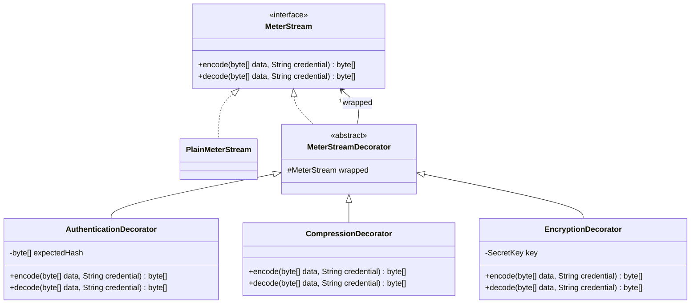

# Part A - Meter message processing

Report source draft, 7 November 2026. Include A1–A3 in the single final submission report. This file and its UML source are separate from application screens and are not packaged in the WAR. Final citation metadata and figure numbering remain to be checked during report assembly.

## A1. Pattern identification and justification (3 marks)

The **Decorator pattern** adds authentication, compression and encryption to a meter message without changing its base component. All components implement `MeterStream`, which exposes `encode()` and `decode()`. `PlainMeterStream` copies the original bytes; a decorator holds another `MeterStream`, delegates work to it and adds one responsibility.

This follows the wrapping structure taught in the supplied class notes, where a base item gains additional behavior through wrappers (Object Oriented Design Patterns - II, n.d., PDF pp. 2–5). SmartCity360 adapts that structure to a sequence of bounded meter messages. Java cryptography and compression APIs provide the actual transformations; those APIs are supporting technology, not additional selected design patterns.

Decorator fits better than creating a subclass for every feature combination. Three optional features give eight combinations. The same base and three wrappers support all eight, selected at runtime by the page's checkboxes.

## A2. Flexible, layered enhancement (4 marks)

`MeterService` creates a fresh component chain for each submission. With all options selected, its structure is:

`AuthenticationDecorator(EncryptionDecorator(CompressionDecorator(PlainMeterStream)))`

The outer authentication wrapper first checks the supplied meter credential. It delegates to encryption, which asks its inner compression wrapper to process the base message. Compression produces GZIP bytes; encryption then transforms those bytes. The resulting order is **credential check → base message → compression → encryption**.

Recovery uses the same saved layer flags. Authentication checks the current meter credential; encryption decrypts; compression expands the message; the base returns the recovered bytes. The service verifies that the original and recovered bytes match before saving a reading and replacing its building's usage total. Failure leaves both reading history and building usage unchanged.

Authentication means checking a randomly generated credential issued for that registered meter. The database stores its SHA-256 hash; the plaintext credential is returned only when issued or replaced. Java's `MessageDigest` supplies the digest operation (Oracle, n.d.-b). This is a meter credential check, not user login.

Encryption uses Java `Cipher` with AES-GCM, a 256-bit key, a fresh random 12-byte nonce and a 128-bit authentication tag. GCM validates its tag during decryption; Java's documentation emphasizes that IVs must not be reused with the same key (Oracle, n.d.-a). The nonce travels with the ciphertext. The private key remains in the local Payara domain, outside the repository and database.

Compression uses Java's GZIP streams (Oracle, n.d.-c). Recovery limits expanded data to 64 KiB. Base64 is only the printable representation of processed bytes; it is not encryption.

### Supporting UML source

The Part A question does not explicitly require a UML figure, but this diagram supports the overall documentation and viva. It must be rendered and labelled in the final report.

## A3. Long-term reuse and extensibility (8 marks)

**One responsibility per wrapper.** Authentication, compression and encryption can be understood and tested separately. The base component does not change when an option is switched on. The service and browser use the common operation rather than knowing transformation implementation details.

**Runtime composition.** A new request can select different options without rebuilding Java. The seven Decorator unit tests include all eight combinations, Unicode byte recovery, incorrect credentials, wrong keys, corrupted data, fresh nonces, compression behavior and bounded decompression. These tests protect the common contract when a wrapper changes.

**Reuse across messages.** The same pattern can process a different bounded meter-message format because transformations work on bytes. Domain validation and the decision to update a building remain in `MeterService`, not in the encryption or compression classes. An additional logging or validation wrapper could be introduced without editing `PlainMeterStream`; it would still need its own tests and deliberate placement in the chain.

**Ordering matters.** Decorators are composable but not interchangeable in arbitrary order. Compressing ciphertext is usually ineffective, while authenticating only after expensive work wastes effort on invalid requests. This implementation fixes the supported transformation order and varies which layers are present. Stored flags let recovery rebuild that same order; any future algorithm/format changes should add explicit format versioning rather than assume old payloads use the newest scheme.

**Costs are measurable.** Every wrapper adds work and can allocate another byte array. GZIP and encryption headers/tags may outweigh savings on small readings. In the browser demonstration, an 87-byte message became 132 encoded bytes with all layers enabled, before Base64 expansion. The interface reports that increase. The compression unit test proves reduction for repetitive test data, but the project does not claim all readings become smaller or that high-volume throughput has been benchmarked.

**Keys and credentials have lifecycles.** The domain key survives application redeployment and server restart. Losing it prevents recovery of encrypted historical payloads, so private backups must include both the database and key. If encrypted records already exist and the key is missing, the service refuses to create a replacement silently. Meter credential replacement is separate: it invalidates the old credential and uses the new one for later checks, including recovery of earlier authenticated readings. Key rotation across multiple retained encryption keys is not implemented.

**Security boundaries must remain clear.** Selecting authentication off intentionally skips that wrapper for the assignment demonstration. This is not an application authorization policy. The local app has no user login/role enforcement yet, and registration/credential replacement are local demo operations. Payload encryption does not hide stored usage metadata or protect the browser-to-server HTTP connection. A production deployment would need HTTPS, authenticated operators and permission checks independently of Decorator.

**Integration without double counting.** An accepted message replaces the building's current usage total; the Composite then calculates district/city totals. Historical messages remain available for inspection and recovery but are not all summed. The current product assumes manually entered totals for a common reporting period. It is a local meter-message simulation, not a continuous connection to physical meters or a historical billing system.

## Evidence and viva explanation

- Pattern code: `src/main/java/lk/osini/smartcity360/pattern/decorator/`.
- Integration: `MeterService`, `MeterKeyStore`, `MeterResource`, `Meter`, `MeterReading`, `database/004_meters.sql`.
- Unit verification: seven Decorator tests; 18 total project tests.
- Live checks: `node scripts/verify-meters.mjs`; dated observed results are in `docs/VERIFICATION.md`.
- Browser evidence: `evidence/meter-recovery.png`.

Viva explanation: “The plain meter message is the base component. I wrap it with the features the user selects. Each wrapper implements the same interface and delegates to the component inside it. Compression and encryption really transform the bytes. I reverse those transformations and check the original message before updating building usage.”

## Reference draft

- *Object Oriented Design Patterns - II* (n.d.) [Class notes supplied for OODP II], PDF pp. 2–5. Confirm author/institution and year from source metadata before final submission.
- Oracle (n.d.-a) *Cipher, Java SE 21 API documentation*. Available at: https://docs.oracle.com/en/java/javase/21/docs/api/java.base/javax/crypto/Cipher.html (Accessed: 7 November 2026).
- Oracle (n.d.-b) *MessageDigest, Java SE 21 API documentation*. Available at: https://docs.oracle.com/en/java/javase/21/docs/api/java.base/java/security/MessageDigest.html (Accessed: 7 November 2026).
- Oracle (n.d.-c) *GZIPInputStream, Java SE 21 API documentation*. Available at: https://docs.oracle.com/en/java/javase/21/docs/api/java.base/java/util/zip/GZIPInputStream.html (Accessed: 7 November 2026).
