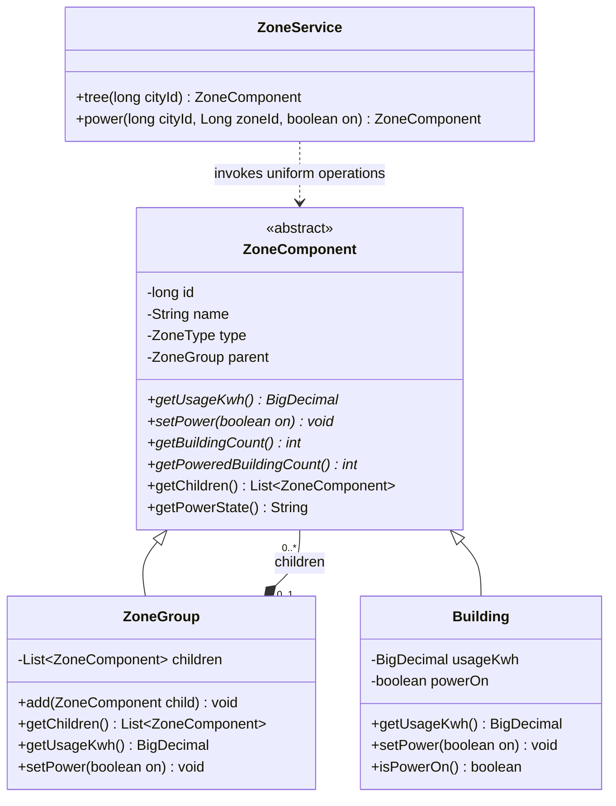

# Part B - Smart-zone hierarchy

Report source draft, 7 November 2026. This material belongs in the single final submission report, alongside A, C, D, E and the system documentation. It is not an application screen and is not packaged in the WAR. Final figure numbering, screenshots and reference metadata will be checked when the report is assembled.

## B1. Pattern identification and justification (3 marks)

The **Composite design pattern** represents the SmartCity360 hierarchy: a city contains districts, a district contains streets, and a street contains buildings. A building is an individual item (a leaf), while the other levels are groups (composites).

Both implement the same operations through `ZoneComponent`: `getUsageKwh()` reports recorded energy use and `setPower(boolean)` changes simulated power. A caller can therefore issue an operation to one building or to an entire district using the same method. A group delegates the operation to its children, recursively, until the buildings are reached.

This follows the component/composite/leaf structure taught through the file-and-folder example in the supplied class notes (Object Oriented Design Patterns - II, n.d., PDF pp. 5–9). SmartCity360 adapts the roles to city infrastructure; the Java implementation and persistence integration are project-specific.

## B2. UML class diagram and mechanism (4 marks)

The following Mermaid source will be rendered as a labelled UML figure in the final report. Abstract operations are marked with `*` in Mermaid notation. `ZoneGroup` owns its children; subclasses inherit the common component operations.

`ZoneGroup` represents CITY, DISTRICT and STREET using `ZoneType`; separate classes are unnecessary because these levels use the same aggregation and delegation behavior. `Building` represents BUILDING and stores the leaf state. The strict type order prevents cycles, and `attachTo()` prevents a component instance from belonging to two parents. The root city has no parent.

For example, Library records 12.125 kWh and Clinic records 7.875 kWh under Lake Road. Community Hall records 5 kWh in a different district. The first district totals 20 kWh; the city totals 25 kWh. Calling `setPower(false)` on the first district turns off Library and Clinic while Community Hall remains on. The city's power state becomes MIXED. The recorded total remains 25 kWh because switching off power does not undo earlier consumption.

The web request follows this path:

1. The browser sends the selected zone and requested state to `ZoneResource`.
2. `ZoneService` loads the city's stored hierarchy and builds the Composite objects.
3. The service invokes `setPower()` on the selected `ZoneComponent`.
4. A `ZoneGroup` passes the call to its children; a `Building` changes its own state.
5. The service saves the resulting building states in one JPA transaction and returns updated totals.

`ZoneEntity` is a database mapping, not another design pattern. It keeps JPA details out of the small pattern classes. PostgreSQL stores each district/street/building with its city and parent IDs; the city itself uses the existing `City` record. Root commands use a null zone ID, so city and zone numeric IDs cannot be confused.

## B3. Support for large and growing infrastructure (8 marks)

**Uniform client code.** The service calls the same operation regardless of whether the target is a leaf or a group. Adding buildings to a street does not require a new power-control method. The same recursion handles the expanded tree.

**Local responsibility.** A building manages its own reading and simulated state. A group aggregates or delegates. This keeps the core logic small and independently testable, and avoids duplicating loops for city, district and street levels.

**Controlled growth.** New districts, streets and buildings are stored as records without recompiling the application. The present hierarchy deliberately permits four fixed levels. Adding a new kind of level would require changing `ZoneType`, validation, database constraints and the interface; it is not claimed to be configuration-only.

**Correctness.** Decimal totals use `BigDecimal`. The API rejects negative or over-precision readings and cross-city parents/commands. Each mutation locks the city row and uses one transaction, so simultaneous operations on the same city are serialized. Empty groups return zero usage and an EMPTY power state. These choices make invalid or ambiguous states visible.

**Costs and limitations.** A recursive operation visits the selected subtree, so its core cost grows linearly with the number of descendants. The current service loads and reconstructs the whole city even for a single-building update, and returns the full tree. Memory, response size and page rendering therefore grow with city size. The row lock also means writes to one city wait for each other. This is suitable for the assessed demonstration but has not been load-tested for a real municipal deployment.

For larger deployments, measure the actual bottleneck before introducing subtree loading, lazy UI expansion, cached aggregate totals or asynchronous commands. Caching needs invalidation when readings change; asynchronous commands need progress/failure records and cannot claim immediate success. Real devices may be offline or fail mid-command, unlike the current transactional simulation. Composite provides the structure for delegation; it does not solve those operational issues itself.

Readings represent manually entered totals for a common reporting period. Saved meter-reading history and authentication are implemented. Explicit reporting-period records and physical meter ingestion remain outside the current implementation. Group totals must not be described as live telemetry or calculated by summing every historical reading.

## Implementation evidence and viva preparation

- Pattern classes: `src/main/java/lk/osini/smartcity360/pattern/composite/`.
- Persistence and API: `ZoneEntity`, `ZoneService`, `ZoneResource`, `database/002_zones.sql`.
- Five JUnit tests cover aggregation, subtree isolation, ownership, hierarchy rules, empty groups and preserved readings.
- `node scripts/verify-zones.mjs` performs 41 live HTTP checks and verifies concurrent commands and rejected inputs. It retains labelled demonstration data.
- Browser checks covered creating a district/street/building, selecting zones, changing power and saving usage. See `docs/VERIFICATION.md` for the dated results and scope.

Viva explanation: “A building is a leaf. A city, district or street is a group. Both are ZoneComponents, so I can call the same usage or power operation on either. The group passes the work to its children. The service then saves the result in PostgreSQL.”

## Reference draft

*Object Oriented Design Patterns - II* (n.d.) [Class notes supplied for OODP II], PDF pp. 5–9. Author/institution and publication year are not confirmed; complete those details from the source metadata before final submission. No author or date has been invented.
