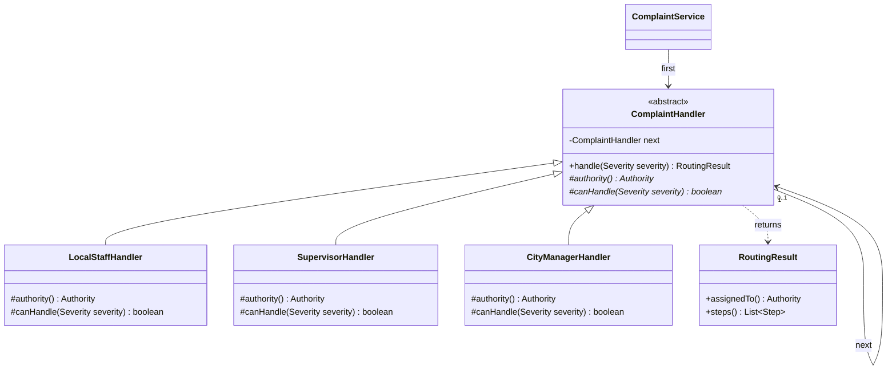

# Part C - Complaint escalation

Report source draft, 7 November 2026. Include this material in the single final submission report with the other assessment answers. It is separate from application screens and is not packaged in the WAR. Final citation metadata and figure numbers remain to be completed during report assembly.

## C1. Pattern identification and justification (3 marks)

**Chain of Responsibility** is appropriate for severity-dependent complaint escalation. The sender passes a complaint to the first handler, which either accepts it or forwards it to its successor. The sender does not need to choose the final responsible authority.

SmartCity360 uses this chain:

`LocalStaffHandler → SupervisorHandler → CityManagerHandler`

Local staff accept LOW complaints. A supervisor can accept LOW or MEDIUM complaints, but normally receives only those forwarded by local staff. The city manager can accept all supported severities and normally receives HIGH complaints. Processing stops at the first accepting handler. This follows the handler/successor structure in the supplied class notes (Object Oriented Design Patterns - II, n.d., PDF pp. 17–20).

Severity thresholds are project business rules, not rules mandated by the design pattern. The interface describes them clearly so a demonstration user can choose the appropriate level.

## C2. Decoupling request handling (4 marks)

The browser sends complaint details and severity to `ComplaintResource`. `ComplaintService` validates the request and invokes `first.handle(severity)` through the abstract `ComplaintHandler` type. It does not use a severity switch to select the final team.

Each concrete handler supplies `canHandle()` and its authority. The base class implements the common accept-or-forward algorithm using its `next` reference. The returned `RoutingResult` contains the assigned authority and an immutable list of handler visits. The service saves the complaint and those visits in PostgreSQL.

For a MEDIUM complaint:

1. Local staff cannot accept it and record FORWARDED.
2. The supervisor accepts it and records ASSIGNED.
3. The city manager is not visited.

The browser and REST endpoint are independent of the chain's length and order. Wiring is centralized in `ComplaintService`; replacing the first handler with a supervisor can model a period when local staff are unavailable. A unit test proves the same caller still works with this alternative chain. This configuration currently changes in Java and requires rebuilding/redeploying; a runtime chain editor is not implemented.

Assignment is distinct from completion. A routed complaint starts as ASSIGNED; a demo operator records IN_PROGRESS and then RESOLVED with mandatory notes. Resolved complaints can be reopened to IN_PROGRESS. Raising severity on an unresolved complaint routes it through the chain again, returns it to ASSIGNED for the new team, and preserves earlier history.

### Supporting class diagram

This UML source supports the explanation; unlike Part B and Part E, the Part C question does not explicitly require its own UML diagram.

## C3. Flexibility and traceability: benefits and drawbacks (8 marks)

**Flexible responsibility.** Each handler owns its acceptance rule. A new specialist handler can be inserted in the chain without changing the complaint submission endpoint. Chain wiring still needs deliberate review, and supporting authority labels/database constraints must be updated if a new authority is introduced. Extensibility does not mean every change is automatic.

**Reduced coupling.** The service knows the first handler and the common operation rather than choosing a specific team for each request. Common forwarding logic is implemented once. The six pure Java tests exercise handler behavior without needing Payara or PostgreSQL.

**Visible decisions.** History records submission, each forwarded/accepted step, severity escalation, work updates and reopening. The page shows both the current team and the earlier route. When severity changes, the old events remain; they are not replaced with the latest route. This supports explanation during a viva and helps users understand why a team received the complaint.

**Explicit failure handling.** A chain can end without a handler accepting the request. `ComplaintHandler` returns an UNHANDLED step with no assigned authority rather than silently dropping the request. The service can persist this as UNASSIGNED. The normal three-handler chain covers all three supported severities; the unhandled case is tested using a shortened chain. Repairing an intentionally incomplete chain or adding manual assignment remains an administrative extension, not an existing screen.

**Order dependence.** The first accepting handler wins. Placing the manager first would send every complaint to the manager and bypass local staff. A very broad acceptance rule could similarly hide later handlers. Tests for all three severities are therefore necessary after changing the chain.

**Processing and storage costs.** Routing visits at most the handlers up to the accepting one, so cost grows with chain length. The present chain contains three handlers. Every visit also creates a stored event. The application flushes events individually to guarantee their generated IDs follow handling order; they still belong to one transaction. This adds database work, but avoids misleading history ordering. No high-volume benchmark has been performed, and the current queue loads all complaints for a city before browser filtering. Pagination/index usage and retention would need attention as data grows.

**Traceability needs supporting design.** The pattern alone does not provide persistent history, transactions, authorization or timestamps. SmartCity360 adds JPA/PostgreSQL persistence, ordered events and work notes. The application database role can insert/read history but cannot update/delete it. This is not a cryptographically tamper-proof audit: a database administrator can still change records, and demo operator identity is not authenticated. User accounts and role enforcement remain pending.

**Concurrent changes.** Mutations lock and refresh the complaint record and check the version supplied by the browser. A stale window receives HTTP 409 and must refresh. A live test with two concurrent updates showed one accepted change and one conflict, with only one work-history event. Complaint and history changes commit together, avoiding a status change with a missing explanation.

The current system routes to authority roles rather than sending real notifications or allocating named staff members. It demonstrates the assessed chain and a functional local work lifecycle without claiming integration with a municipality.

## Evidence and viva explanation

- Pattern code: `src/main/java/lk/osini/smartcity360/pattern/chain/`.
- Persistence/API: `Complaint`, `ComplaintEvent`, `ComplaintService`, `ComplaintResource`, `database/003_complaints.sql`.
- Six chain unit tests cover all three routes, a shortened chain, changed wiring and independent/immutable results.
- The live regression script is `scripts/verify-complaints.mjs`.
- Browser evidence: `evidence/complaint-resolved.png` and `evidence/complaint-history.png`.
- Full dated verification and limitations: `docs/VERIFICATION.md`.

Viva explanation: “The complaint starts at local staff. If they cannot handle its severity, they pass it to the supervisor, then to the city manager if necessary. The first suitable handler accepts it. I save each visit so the user can see the route. Being assigned does not mean resolved; the work status is updated separately.”

## Reference draft

*Object Oriented Design Patterns - II* (n.d.) [Class notes supplied for OODP II], PDF pp. 17–20. Confirm the author/institution and date from the source metadata before final submission; no missing details have been invented.
