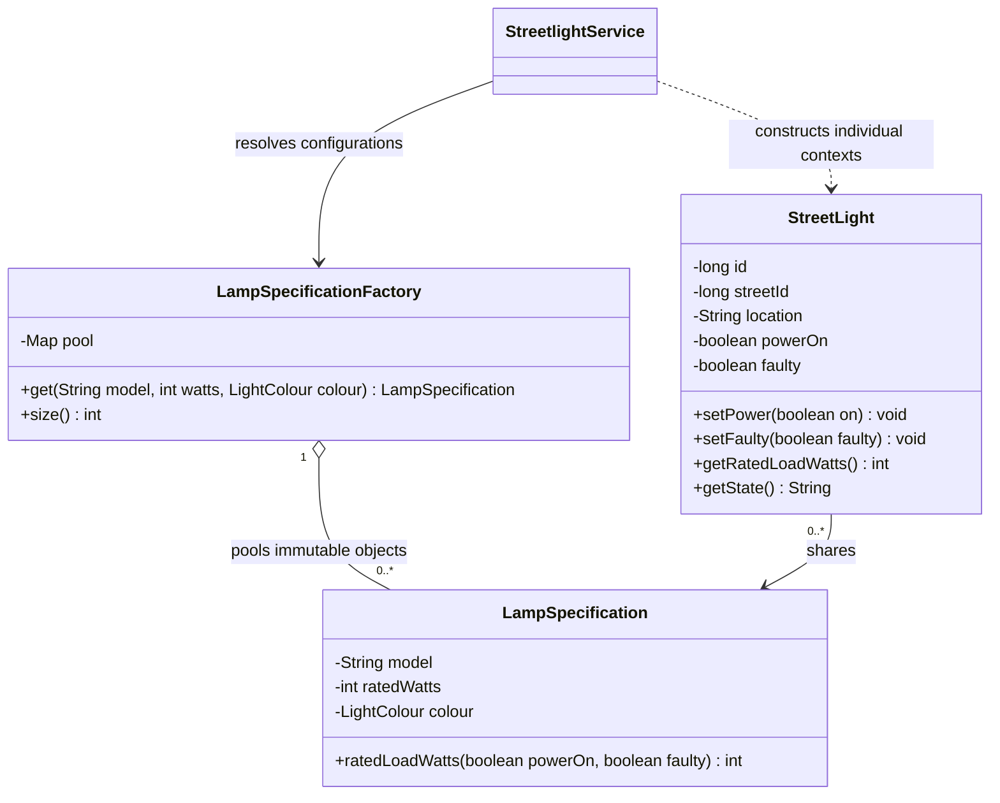

# Part D — Shared streetlight specifications

Report source draft, 8 November 2026. Include D1–D3 in the single final submission report. This document and its UML source are separate from the deployed application. Final figure numbering and source metadata remain to be checked during report assembly.

## D1. Pattern identification and justification (3 marks)

The **Flyweight pattern** reduces duplicated intrinsic state when a city has many streetlights with relatively few lamp configurations. SmartCity360 shares one immutable `LampSpecification` per combination of model, rated watts and light colour. Individual lights retain their own location and operating state.

This applies the sharing approach taught in the supplied class notes (Object Oriented Design Patterns - II, n.d., PDF pp. 20–25). The `LampSpecificationFactory` is the pool/factory role within Flyweight, not an additional selected design pattern. It returns an existing specification when the configuration already exists and creates one otherwise.

For example, two lights on different streets can both reference the same CityLED 40 specification. Switching one light off changes that light's context, leaving the other light on. Copying a specification for every lamp would repeat the same model, wattage and colour state without adding information.

## D2. Intrinsic and extrinsic state (4 marks)

| State | Location in this implementation | Reason |
|---|---|---|
| Model, rated watts, light colour | Immutable `LampSpecification` | Shared intrinsic state: identical for all lights using that configuration |
| Light ID, street ID, location | Individual `StreetLight` context | Extrinsic identity and placement vary per light |
| Commanded power and fault status | Individual `StreetLight` context | Mutable extrinsic state must not affect other lights |
| Label, current fault note and edit version | Individual `StreetlightEntity` record | Persistent per-light details; never stored in the shared specification |

The service loads an inventory page, resolves each specification through the application-scoped pool and constructs an individual context for each row. It counts shared objects by identity, so identical values alone do not establish the reported sharing. `ConcurrentHashMap.computeIfAbsent` protects pool lookup/creation when requests run concurrently. Specifications expose no mutation methods.

`StreetLight.getRatedLoadWatts()` passes its power and fault values to `LampSpecification.ratedLoadWatts(powerOn, faulty)`. Thus shared behavior uses the current context without saving that context inside the shared object. The calculation returns rated watts only when the light is on and healthy. This is a stated simulation assumption, not measured power or energy consumption.

Changing one light's configuration updates its specification reference in storage. A newly reconstructed context refers to the selected pooled object; other lights continue to use their previous specification. Shared configurations are not edited in place.

PostgreSQL stores one `lamp_specification` row per unique configuration, referenced by multiple `streetlight` rows. That reduces stored duplication, while the Java pool separately provides runtime object sharing. A foreign key alone would not prove a Flyweight implementation. After application restart, the pool is reconstructed from requested persisted configurations.

### Supporting UML source

Render and label this supporting figure when assembling the final report. The pattern classes are distinct from JPA persistence entities.

## D3. Effect at tens of thousands of lights (8 marks)

Let **N** be the number of lights and **K** the number of distinct specifications. Without sharing, each light can require its own specification object, giving N specification instances. Flyweight reduces those instances to K while retaining N independent light contexts. It is most useful when K is much smaller than N.

An illustrative storage model is `N × (E + I)` without sharing, compared with `N × (E + R) + K × I + pool overhead` with sharing. Here E represents individual context state, I intrinsic specification state and R a shared reference. This explains the tradeoff; it is not a measured byte count. Real JVM memory also depends on headers, alignment, map entries, strings and temporary allocations.

### Executed evidence

The isolated Java demonstration builds 100,000 contexts using three shared configurations. It also constructs 100,000 separate baseline specification objects and retains them during identity counting. This yielded:

| Observation | Result |
|---|---:|
| Individual light contexts | 100,000 |
| Shared specification identities | 3 |
| Unshared baseline specification identities | 100,000 |
| Specification objects avoided in the shared design | 99,997 |
| Independent state for two lights sharing a specification | Passed |
| Database records created by the demonstration | 0 |

The browser demonstration recorded 106.30 ms for the combined operation on this local machine; a separate API execution recorded 375.96 ms. These are uncontrolled observations, not a comparison of shared versus unshared speed. The timer includes constructing both sets and counting them. No heap measurements or fixed memory-saving percentage are claimed. The baseline compares specification objects; it does not create a second complete application inventory.

Six Flyweight unit tests passed, including 100,000 contexts and concurrent pool lookups. Fifty-five HTTP checks passed for inventory creation, pagination, configuration reuse, independent switching/faults, stale-edit rejection, concurrent updates, validation and the isolated demonstration. Browser checks added a fourth saved light, created a new specification, switched that light off, then recorded a fault. After restarting PostgreSQL and Payara, all four saved records, versions and the fault note matched the saved snapshot. The reconstructed page again used three specification identities for those four contexts.

Evidence images: `evidence/streetlight-workspace.png` and `evidence/streetlight-sharing.png`. The complete verification scope is recorded in `../VERIFICATION.md`.

### Performance implications and limits

Fewer repeated specification objects can reduce retained intrinsic state and repeated object creation. Immutable sharing also avoids synchronizing edits to the shared data. Pool lookup and map storage add overhead, however, and each light still needs its own context. If nearly every light has a unique configuration, K approaches N and the benefit shrinks; the pool can cost more than it saves.

The live inventory loads bounded pages: 25 lights in the UI and at most 100 per API page. City-wide counts and rated-load totals are calculated by database queries. This avoids constructing every light merely to display one page, but the in-memory 100,000-light demonstration does not prove database throughput for 100,000 persisted rows.

The application pool retains requested configurations until restart/redeployment and currently has no eviction. A large number of unique configurations therefore increases its memory use. Database uniqueness and immutable specifications preserve reuse; concurrency tests verify that simultaneous requests for one configuration obtain the same pooled identity. The demonstration is bounded and serialized to limit simultaneous temporary allocations.

This implementation simulates power commands and fault state. It does not connect to physical lamps, estimate energy over time, retain maintenance history or demonstrate production access controls.

## Simple viva explanation

“Every streetlight needs its own location and on/off state, but thousands can use the same lamp model. I store the model, watts and colour once in an immutable specification and share it. Switching one light off changes only that light. My demonstration shows 100,000 contexts using three specification objects; it does not claim that the whole application has only three objects.”

## Reference for final Harvard bibliography

*Object Oriented Design Patterns - II* (n.d.) [class lecture notes], PDF pp. 20–25. Supplied course material. Confirm lecturer/institution metadata from the original document before final submission. The implementation and measured observations above are original project evidence, not external performance claims.
