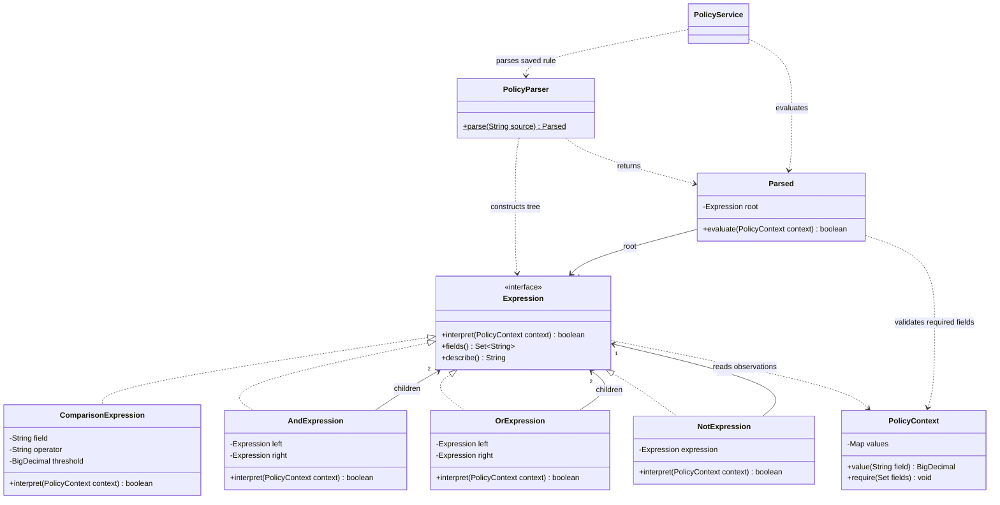

# Part E - Interpreting city policies

Report source draft, 8 November 2026. Include E1–E3 and the rendered UML figure in the single final report. This material is separate from the application and is not packaged in its WAR. Figure numbering and final Harvard source metadata remain to be completed during report assembly.

## E1. Pattern identification and justification (3 marks)

The **Interpreter pattern** fits SmartCity360's small policy language. It represents a rule as expression objects, with a common `interpret(context)` operation. Terminal expressions evaluate individual comparisons, while nonterminal expressions combine other expressions using `AND`, `OR` and `NOT`.

The supplied class notes introduce an `Expression` interface, terminal expressions and a nonterminal expression that combines two child expressions (Object Oriented Design Patterns - II, n.d., PDF pp. 25–27). Their arithmetic example is adapted here to boolean city policies. The parser translates user-entered text into those objects; the Java expression classes perform the actual interpretation.

For example, `noise > 65 AND (hour >= 22 OR hour < 6)` describes a fictional overnight noise violation. It becomes an `AndExpression` with a noise comparison on its left and an `OrExpression` for the two hour comparisons on its right. A `PolicyContext` supplies the observed values. A result of true is interpreted using the policy's saved meaning, because a noise rule may describe a violation while a parking rule may describe permission.

This makes supported policy edits data changes: an administrator can change 65 to 75, save the text and evaluate the revised rule without changing or recompiling Java classes.

## E2. UML class diagram and mechanism (4 marks)

The following is the source for the required class diagram. Render it as a readable figure in the final PDF; do not submit only the source block.

`Parsed` is a public nested record of `PolicyParser`. The expression implementations are immutable Java records. Their private record components appear as attributes in the diagram; generated accessors are omitted for readability. The static `parse` operation is underlined when rendered by a compatible UML renderer.

### Execution sequence

1. The browser sends a policy expression to the Jakarta REST resource. Java validates syntax when saving; an optional syntax-check action also returns explicit grouping and required fields without saving anything.
2. `PolicyParser` tokenizes the text and builds the tree. Its grammar applies `NOT` before `AND` before `OR`, with parentheses overriding grouping. Unknown fields, malformed comparisons and leftover tokens produce errors with character positions.
3. On evaluation, `PolicyService` loads the saved policy and checks its city, active flag and submitted edit version. The observation zone must belong to that city.
4. `PolicyContext` validates numeric values. `Parsed.evaluate()` checks every field referenced anywhere in the tree before calling the root. Missing input cannot be hidden by a short-circuited boolean branch.
5. Each comparison reads its field and compares it with its threshold using `BigDecimal`. Nonterminal expressions recursively combine boolean results. `describe()` displays the actual parsed grouping, not a separate interpretation of the user's text.
6. The service saves the result with a snapshot of the rule, meaning, revision, observations, zone and evaluation timestamp. These operations occur within a transaction.

The pattern remains visible in ordinary Java classes. REST transport, a bounded recursive-descent parser, JPA and PostgreSQL support the application; they are not additional selected patterns for this question.

## E3. Suitability for rule updates and extensibility (8 marks)

### Strengths

The expression tree separates the grammar's meaning from the interface and persistence code. Existing expressions can be recombined and their thresholds edited without adding a Java subclass for each city policy. The same comparison class serves noise, hour and parking-duration checks. Parentheses and boolean operators allow more useful rules than a fixed list of form checkboxes.

Each node has a small, testable responsibility. Comparison tests check exact boundaries, while combination tests check precedence and negation. Decimal comparison avoids equality surprises from trailing zeros. Immutable expression nodes and contexts avoid accidental state changes while interpreting a rule; each parse uses a fresh parser instance.

Saved evaluation snapshots make rule changes explainable. For example, the browser used 70 dB at hour 23: a 65 dB threshold produced a violation at revision 1, while changing the threshold to 75 dB produced no violation at revision 2. The earlier result still displayed the 65 dB rule and original observation. This provides traceability for evaluated rules rather than retroactively applying the latest text to every result.

The UI stops evaluation while its draft has unsaved changes, and the server independently checks the requested saved version. City-level transactional locking serializes competing edits/evaluations; a stale request returns 409. Inactive rules retain their history while rejecting new evaluations.

### Extensibility and tradeoffs

Changing a threshold or combining existing comparisons is a runtime update. Adding a genuinely new language feature is a software change. A new numeric field needs context validation, parser recognition, observation input, persistence mapping and tests. A new boolean operator needs an expression implementation, grammar/precedence changes and tests. Dates, units, functions or arithmetic would require more substantial grammar and type design. Interpreter does not make arbitrary language extensions automatic.

For a small grammar, the classes are easy to follow in a viva. As a language grows, the number of node types, parser cases and interactions can become difficult to maintain. Users may also write syntactically valid rules with the wrong meaning. Explicit grouping, a clear true-result meaning, examples and boundary tests help, but do not replace policy review.

Parsing allocates an expression tree for each operation, and recursive interpretation visits relevant nodes. Boolean operators can short-circuit evaluation, but the application deliberately validates all required observations first. Parsing is currently repeated instead of cached. A future cache would need keys including policy revision and language version to avoid using outdated rules. No large-policy throughput benchmark has been performed.

Resource limits keep this implementation bounded: 1,000 source characters, 200 tokens, 20 nested groups/negations and 20 characters per numeric literal. The language accepts only known numeric fields and explicit operators; it has no script execution, external calls or loops. These restrictions are part of making a small, explainable DSL, not proof of complete production security. Application access controls remain separate work.

The observations are manual demonstration data: noise 0–200 dB with up to three decimal places, whole hours 0–23, and whole parking minutes 0–10080. Overnight windows use an `OR` expression. The language does not handle minutes within an hour, time zones, calendars, holidays or continuous sensing. A result is recorded for one selected zone; it does not automatically switch devices, issue penalties or establish legal compliance.

History preserves evaluated revisions and their inputs, but is not a complete audit log of every policy edit. An intermediate rule that is edited again before evaluation has no separate historical snapshot. Similarly, future changes to language semantics would need an explicit language-version strategy; the current implementation does not migrate or replay old rules automatically.

### Verified evidence

- Nine Interpreter unit tests passed; the full project suite passed 33 tests with zero failures/errors.
- Eighty-four HTTP checks passed: true/false noise and parking cases, boundaries, rule updates, unchanged history, duplicate names, city isolation, invalid input, pagination, inactive policies, stale versions and competing edits.
- The browser created a policy, saved a true result, edited its threshold, saved a false result and displayed both original revisions. An incomplete `noise >` rule showed an error at character 8. Unsaved edits disabled evaluation.
- Evidence image: `evidence/policy-history.png`. Restart verification and complete scope are recorded in `../VERIFICATION.md`.

## Simple viva explanation

“I turn the rule text into a tree of expression objects. A comparison checks one observation, and AND, OR or NOT combine the results. Changing a number in a saved rule creates a new evaluation behavior without recompiling Java. Adding a new kind of language feature still needs code. Every result keeps the rule used at that time.”

## Reference for the final Harvard bibliography

*Object Oriented Design Patterns - II* (n.d.) [class lecture notes], PDF pp. 25–27. Supplied course material. Confirm lecturer/institution details from the original document before final submission. Test outcomes and browser observations above are original project evidence.
